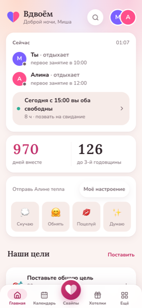
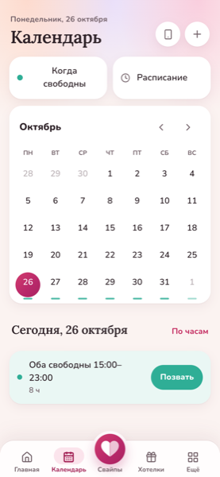
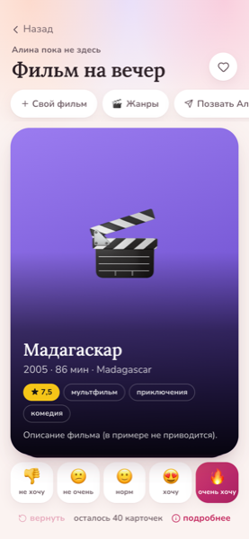
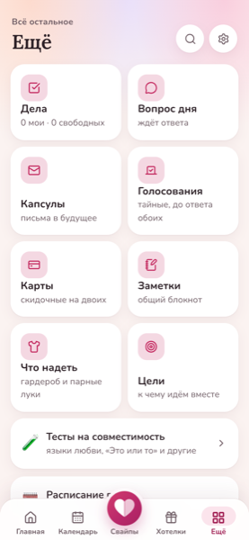

# Вдвоём

Телеграм-бот с мини-приложением для пары: общий календарь со свободными окнами обоих, свайпы с мэтчами (фильм на вечер, куда сходить, куда поехать), хотелки, дела, капсулы-письма в будущее, тайные голосования, вопрос дня, тесты на совместимость и кнопка «скучаю». Расписание можно сфотографировать: его распознаёт YandexGPT с OCR, а свободные окна потом считает уже код.

<p>
  
  
  
  
</p>

Снимки сделаны на тестовой паре из `e2e/seed.ts`.

## Стек

- **Сервер:** Node.js 24 (TypeScript исполняется напрямую, без сборки), Hono, grammY, SQLite (`node:sqlite`), Server-Sent Events для живых обновлений между партнёрами.
- **Мини-приложение:** React + Vite, Telegram WebApp API.
- **ИИ:** YandexGPT и Yandex Vision OCR, чтобы разобрать фото расписания. Есть месячный потолок трат и учёт стоимости каждого запроса.
- **Оплата:** ЮKassa (подписка «Вдвоём+», чеки 54-ФЗ).
- **Тесты:** `node:test` для сервера (115 тестов) и Playwright e2e на трёх профилях (Chrome, WebKit, Android-вьюпорт), включая аудит кликабельности кнопок.
- **Выкат:** Docker Compose за общим Caddy, rsync-скрипт.

## Архитектура

- `server/src/auth.ts` проверяет подпись `initData` Telegram, и только она определяет личность пользователя. Вход без Telegram (`DEV_AUTH`) открыт лишь в разработке, а на проде сервер с этим флагом не стартует.
- `server/src/routes/` — API разделов: `core` (профиль, пара, SSE-поток), `schedule`, `shared`, `fun`, `testy`, `plus`, `admin`.
- `server/src/slots.ts` — арифметика общих окон с учётом дороги, онлайн-занятий и отмен. Время везде московское, фиксированным смещением.
- `server/src/scheduleAi.ts` и `schedText.ts` распознают расписание с фото или текста, а `rea.ts` и `icsImport.ts` подтягивают его с сайта вуза или из календаря `.ics`.
- `server/src/preview.ts` достаёт название, цену и картинку по ссылке на хотелку и защищён от запросов во внутреннюю сеть (SSRF).
- `server/src/cron.ts` раз в минуту открывает капсулы, присылает вопрос дня, напоминает о днях рождения и годовщинах и собирает воскресную сводку.
- `server/src/limits.ts` и `plus.ts` реализуют бесплатные лимиты, подписку и акцию.
- `web/src/` — экраны в `screens/`, связка с Telegram в `tg.ts`, общий стор в `store.ts`.

## Запуск локально

```bash
cd server && npm install && cd ../web && npm install && cd .. && npm install
npm run dev:server        # сервер на :3000 с DEV_AUTH, база ./server/dev.db
npm run dev:web           # Vite на :5173 с прокси на сервер
```

В браузере `http://localhost:5173/?dev=1` и `?dev=2` открывают двух тестовых людей в двух вкладках: так проверяются мэтчи и живые обновления. `?still=1` выключает анимации, `?go=movies` открывает нужный экран.

```bash
npm test                  # модульные тесты сервера
npm run typecheck
npm run e2e               # сквозные тесты: сами поднимают сервер на :3100 и сайт на :5174
```

В `server/data/` лежат урезанные образцы справочников (см. `server/data/README.md`). Постеры и фото мест в репозиторий не входят: скрипты `server/scripts/build-movies.py` и `hd-images.mjs` собирают их из открытых источников.

## Выкат

1. Создать бота у @BotFather и заполнить `.env` по `.env.example`.
2. `DEPLOY_HOST=root@<сервер> deploy/vykat.sh` копирует код на сервер и пересобирает образ. Блок для Caddy лежит в `deploy/Caddyfile.vdvoyom`.
3. Для сети Docker нужен IPv6: с некоторых российских хостингов `api.telegram.org` по IPv4 доступен нестабильно.
